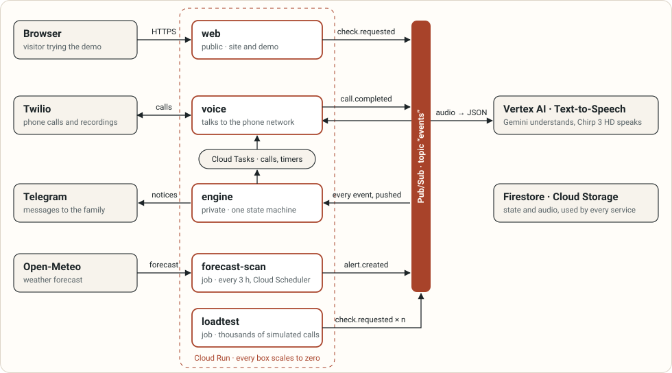

# Kuc-kuc

**A knock on the door when dangerous weather comes.** ("Kuc-kuc" is Serbian for "knock-knock".)

When a heatwave or a hard frost is forecast, Kuc-kuc phones an older person who lives alone and
asks if they are all right. They just answer out loud, on any phone, including a landline.
If they do not answer, or say they are not well, it phones a neighbour and asks them to knock
on the door. The family, far away, sees every step.

It was built for one person, a grandmother in a village in southern Serbia, and for the
[Product Hunt × Google Cloud Run hackathon](https://www.producthunt.com/contests/google-cloud-run-november-26) ("Build for Good").

**This is not an emergency service.**

## How it is built



Three services and four jobs, all on Cloud Run, all with a minimum of zero instances.
No service calls another directly: what happened is an event on a Pub/Sub topic, and whatever
has to happen later is a Cloud Tasks task with a time on it. Nothing stays awake to wait.

| Part | What it is | What it does |
|---|---|---|
| `web` | Cloud Run service, public | Site, demo API, live timeline, the family page (Google sign-in). Never dials. |
| `engine` | Cloud Run service, internal ingress | One pure state machine decides every next step. |
| `voice` | Cloud Run service | The only code that touches telephony. Speaks, records, asks Gemini what was said. |
| `forecast-scan` | Cloud Run job, every 3 h | Reads the forecast and creates alerts. |
| `watchdog` | Cloud Run job, every 10 min | Closes a check that has stopped moving and tells the family at once. |
| `loadtest` | Cloud Run job | Thousands of simulated people, with telephony replaced by a simulation. |
| `telegram-webhook` | Cloud Run job, after each deploy | Tells Telegram where to deliver what families write to the bot. The bot's token never leaves Secret Manager. |
| Pub/Sub `events` | topic, pushed to `engine` | `check.requested`, `call.completed`, `call.blocked`, `alert.created` |
| Cloud Tasks | queues `calls`, `calls-sim`, `timers` | Every wait: "call again in 10 minutes", "ask the neighbour in 20". |
| Firestore | | People, episodes, calls, timeline. Demo data expires after 24 hours. |
| Cloud Storage | | Cached speech; recorded answers, deleted after 7 days. |
| Vertex AI, Text-to-Speech | | Gemini understands the recorded answer; a Chirp 3 HD voice speaks. |
| Twilio | | Phone calls and number verification. |
| Telegram | | The family's messages: silent for news, ringing for anything urgent. |

Under load: 2,000 simulated people in a heatwave at once made 3,008 simulated calls; every case
was closed in 213 seconds, at a peak of 14 instances, and 13 minutes later nothing was running.

### One check, step by step

1. A check is requested (by the forecast, by the family, or by the demo): an event.
2. `engine` runs `step(episode, event)` in a transaction and gets back a list of actions.
3. A call is a task in the `calls` queue, which releases at most one new call per second.
4. `voice` synthesises every sentence the call may need *before* dialling, then asks Twilio to dial.
5. Up to 8 seconds of answer are recorded and sent to Gemini: audio in, a small JSON object out.
6. `voice` publishes `call.completed`. "I am fine" closes the episode; no answer becomes a task
   ten minutes ahead (three tries at most); anything else calls the neighbour, and the question
   "how is she?" twenty minutes later is one more task.

### The rule that decides everything

**Any doubt counts as a problem.** Silence, a recorded message, a failed download, a model error
or a confused answer is "unclear", and unclear sends someone to the door. It never becomes "fine".

The whole escalation is one pure function, [`src/kuckuc/engine/machine.py`](src/kuckuc/engine/machine.py):
no clock, no I/O, every rule a unit test.

### Limits built in

- At most 6 calls a day to any one person, checked before the first call of a check, so it never
  cuts off an escalation that has started; one switch stops all new calls. A blocked call always
  produces an urgent message to the family.
- A watchdog every ten minutes closes a check that has stopped moving (a lost task, event or
  status report) and tells the family at once. A message that did not reach the family is shown
  as not delivered, never as sent.
- Scheduled calls only between 08:00 and 20:00 where the person lives; introductions until 23:00,
  and one asked for later waits for 08:00 unless the family chooses to call now. An escalation that has started always finishes.
- The public demo calls only a number its owner has just verified, in four countries, twice a day
  per number, inside a daily budget in dollars, and closes itself when the account balance is low.
- Phone numbers never appear in logs, public pages, this repository or its test fixtures.

## Run it locally

Python 3.12. Nothing real is called: telephony, speech and messages are fakes.

```bash
python -m venv .venv
.venv/Scripts/python -m pip install -e ".[dev]"     # on Linux and macOS: .venv/bin/python
.venv/Scripts/python -m pytest
.venv/Scripts/python -m kuckuc.dev                   # http://localhost:8080
```

In the local preview the verification code is always `123456`, and `?fake=ok`, `?fake=silent`
or `?fake=unwell` in the address chooses how the pretend phone answers.

## Deploy it

You need a Google Cloud project with billing, the `gcloud` CLI, and a Twilio account with one
voice-capable number and a Verify service.

```bash
gcloud config set project YOUR_PROJECT
bash deploy/setup.sh        # APIs, service accounts, Firestore, bucket, topic, queues. Safe to re-run.
```

Create four secrets yourself, so the credentials never pass through a script:
`twilio-account-sid`, `twilio-auth-token`, `twilio-verify-sid`, `twilio-from-number`.

```bash
bash deploy/deploy.sh       # builds one image with Cloud Build and deploys web, voice and engine
```

Useful afterwards:

```bash
python scripts/call_now.py --lang en     # one test call to your own phone; asks for the number, hidden
python scripts/kill_switch.py on         # stop all new calls; "off" to allow them again
```

## Layout

```
src/kuckuc/
  engine/machine.py     the state machine (pure)
  engine/app.py         events in, actions out
  voice/app.py          call flow: speak, record, understand
  web/                  site, demo API, architecture page
  scripts.py            every sentence spoken on the phone, Serbian and English
  speech/               synthesis with a cache; fail-safe interpretation
  telephony/            Twilio, and a fake for tests
  store.py              storage interface and the in-memory store
  store_firestore.py    the same interface on Firestore
  local.py, dev.py      everything wired in memory, for tests and local preview
deploy/                 setup.sh, deploy.sh
tests/                  over 440 tests; none needs a network
```

## Thanks

Weather data by [Open-Meteo.com](https://open-meteo.com/) (CC BY 4.0).

## Licence

MIT. See [LICENSE](LICENSE).
